<div align="center">

# IrisIp

### Menu-driven network reconnaissance and vulnerability scanning for authorized testing.

Wraps industry-standard tools such as Nmap and Nikto behind a single interactive interface, turning long manual scan commands into fast, repeatable, reportable results.


</div>

<div align="center">

</div>

---

<div align="center">

</div>

## Overview

IrisIp accelerates the reconnaissance phase of a penetration test. You enter a target IP or hostname, pick a scan mode from the menu, and the tool runs the matching Nmap / Nikto command set in the background and prints the results to the terminal. It is built to make the slow, command-heavy early stage of an engagement quick and consistent.

---

## Core Features

| Capability | What it does |
|---|---|
| Port scanning | Detects open TCP/UDP ports and the services behind them |
| Service and version detection | Identifies vendor and version of running services (Apache, SSH, FTP, …) |
| Operating system detection | Infers the target OS from TCP/IP stack behaviour |
| Vulnerability scanning | Uses the Nmap Scripting Engine (NSE) and Nikto to surface known CVEs and misconfigurations |
| Traceroute and firewall detection | Maps the network path and flags intermediate firewalls / WAFs |
| GeoIP / intelligence lookup | Resolves location and basic intelligence for a target address |

---

## Requirements

| Component | Notes |
|---|---|
| Python 3.x | Interpreter |
| Nmap | Core scanning engine |
| Nikto | Web vulnerability checks |
| Linux + root | Several scan types require raw sockets / root privileges |

Missing command-line tools (`nmap`, `arp-scan`, `whois`, `dig`, `curl`) are detected and installed automatically on Debian-based systems.

---

## Installation

```bash
git clone https://github.com/osmnabyram/Siber-IrisIp.git
cd Siber-IrisIp
chmod +x IrisIp.py
```

## Usage

```bash
sudo python3 IrisIp.py
```

On startup the tool shows a menu-driven interface. Enter a target (for example `192.168.1.10` or `scanme.nmap.org`), choose a scan mode (quick scan, comprehensive scan, vulnerability analysis, …), and read the results in the terminal.

---

## Responsible Use

IrisIp is intended **only** for education and for penetration testing on systems you own or are explicitly authorized to assess. Scanning systems without permission is illegal in most jurisdictions and can carry serious penalties. The author accepts no liability for misuse.
